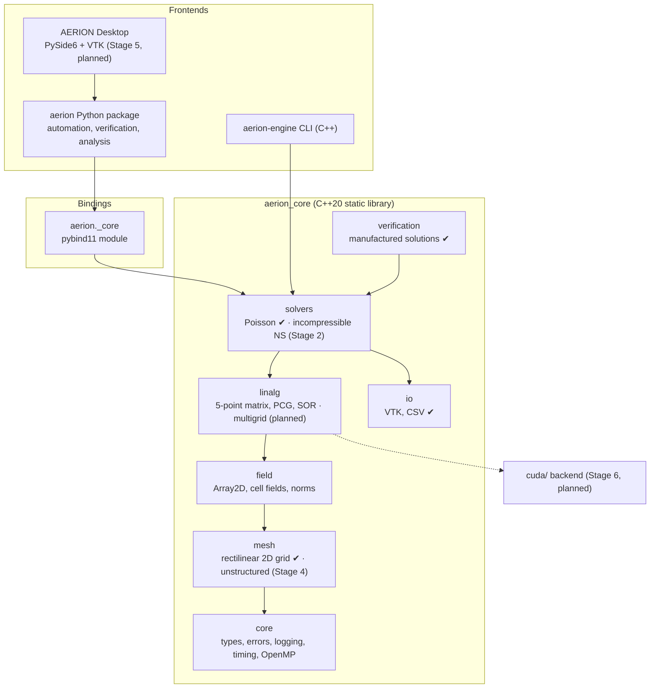

# AERION architecture

*Engineering the Invisible.*

This document describes how AERION is organised, why it is organised that
way, and how the structure grows from the current Stage 1 foundation to a 3D,
turbulent, GPU-accelerated virtual wind tunnel. Sections marked **(planned)**
describe design intent, not existing code.

## 1. Guiding principles

1. **Correctness before features.** A capability counts as available only
   once it is verified (see [VERIFICATION.md](VERIFICATION.md)). Everything
   else is labelled *experimental* in code, docs and UI.
2. **One computational engine, many front ends.** All numerics live in the
   C++ library `aerion_core`. The CLI, the Python package and (later) the
   desktop GUI are thin clients of it. A result therefore never depends on
   which front end produced it.
3. **Honest diagnostics.** Solvers return what actually happened: the
   residuals they computed, non-convergence, stagnation, conservation
   errors. They never "succeed" silently.
4. **Layered dependencies.** Lower layers never include higher ones (enforced
   by directory structure and code review). This keeps the core testable in
   isolation and lets a module such as the mesh be replaced without touching
   the solvers' callers.
5. **Portable by default, fast where it matters.** Plain C++20, with no
   dependency beyond the standard library in the engine. OpenMP is optional,
   CUDA is optional (planned). The CPU path is always available, because the
   project must run on machines without a GPU.

## 2. System overview

## 3. Repository layout

| path | content |
|---|---|
| `include/aerion/` | public C++ headers, one sub-directory per module |
| `src/` | C++ implementation (`aerion_core`) and `src/app/` (CLI) |
| `python/bindings/` | pybind11 bindings (`aerion._core`) |
| `python/aerion/` | Python package: `analysis/`, `verification/`, `cli.py` |
| `tests/cpp/`, `tests/python/` | GoogleTest and pytest suites (both run through CTest) |
| `examples/` | runnable examples, each with a stated reference solution |
| `benchmarks/` | performance programs and recorded per-stage results |
| `docs/` | architecture, roadmap, theory, verification policy, development guide |
| `gui/` | desktop application (Stage 5, not started) |
| `cuda/` | GPU kernels (Stage 6, not started) |
| `cmake/` | build helpers (warnings, dependencies, version generation) |

## 4. Engine modules (C++ namespace `aerion`)

Layers are listed bottom-up. A module may depend only on the modules listed
above it.

### 4.1 `core` — foundation
* `types.hpp`: `Real = double`, `Index = std::ptrdiff_t` (signed, so that
  ghost indices can be negative and OpenMP loops are canonical).
* `error.hpp`: `Error` → `InvalidArgument`, `NumericalError`, `IOError`.
  `require(cond, msg)` attaches file:line. Errors are exceptions, because
  numerical code must not continue on invalid input.
* `logger.hpp`: thread-safe, level-filtered, pluggable sink. Python installs
  a sink that forwards to the `logging` module.
* `parallel.hpp`: `AERION_OMP(...)` pragma macro (a no-op in serial builds)
  and thread control.
* `build_info.hpp`: version, git revision, compiler, OpenMP. This information
  is stamped into every recorded result.

### 4.2 `mesh` — geometry
* `StructuredGrid2D`: rectilinear tensor-product grid built from
  face coordinates. It supports uniform and stretched spacing (`tanh`
  clustering to both walls). Cells are numbered `k = i + nx*j`.
* **(planned, Stage 4)** `UnstructuredMesh2D` with face-based connectivity
  (owner/neighbour, face normals, areas, cell volumes), imported from Gmsh
  `.msh`. This is required for body-fitted airfoil meshes. Solvers will be
  written against face loops, so that the finite-volume operators carry over.

### 4.3 `field` — data containers
* `Array2D<T>`: contiguous storage over arbitrary index ranges. The same
  type holds cell fields `[0,nx)×[0,ny)`, staggered face fields
  `[0,nx]×[0,ny)` (needed by the MAC grid in Stage 2) and fields with ghost
  layers. The layout is i-fastest, identical to the solver vector ordering,
  so no copies are needed between fields and linear algebra.
* Volume-weighted norms and integrals, used for error and conservation
  measures.

### 4.4 `linalg` — linear algebra
* `StencilMatrix2D`: five-point sparse matrix (centre/E/W/N/S), validated
  structure, symmetry and diagonal-dominance checks.
* `conjugate_gradient` (Jacobi-preconditioned) for SPD and singular-consistent
  systems; red-black `sor` (parallel half-sweeps).
* Convergence uses the true residual `‖b−Ax‖₂ ≤ rtol‖b‖₂`. Statuses:
  `Converged`, `MaxIterationsReached`, `Breakdown`, `Diverged`, `Stagnated`.
* **(planned)** BiCGStab for non-symmetric implicit transport; geometric
  multigrid (Stage 6) for the pressure equation. Recorded benchmarks show CG
  iterations growing like O(n), which is why multigrid is needed.

### 4.5 `solvers` — discretised physics
* `PoissonSolver2D`: cell-centred finite-volume ∇²φ = f with Dirichlet or
  Neumann data per side. The matrix is assembled once and reused for many
  right-hand sides. Pure-Neumann problems get a solvability check, a
  projection and a zero-mean gauge. A global conservation diagnostic is
  computed from the discrete boundary fluxes. This is the pressure-equation
  kernel of the projection method.
* **(Stage 2)** `IncompressibleSolver2D`: MAC staggered grid, fractional-step
  projection method, explicit/semi-implicit time integration, CFL and
  viscous stability control, divergence monitoring. See
  [theory/governing_equations.md](theory/governing_equations.md).
* **(Stage 4)** force integration (pressure + viscous wall stresses) and
  aerodynamic coefficients on body-fitted meshes.

### 4.6 `io` — input/output
* Legacy VTK `RECTILINEAR_GRID` (ParaView/VisIt/VTK readable; verified with
  VTK 9.7 in the test-suite) and CSV. All output is written in the "C" locale.
  This matters on Turkish-locale Windows, which uses a decimal comma.
* **(planned)** XML VTK (`.vtr/.vtu`) with binary appended data, `.pvd`
  time series, case files, restart files.

### 4.7 `verification` — code verification support
* Manufactured solutions with analytic sources and boundary data. The Python
  package re-implements them independently in NumPy, so two separate code
  paths must agree.

## 5. Python layer (`python/aerion`)

* `aerion._core`: pybind11 bindings. Cell fields are NumPy arrays of shape
  `(nx, ny)` with "ij" indexing. Data are copied at the boundary (clear
  ownership; the cost is negligible compared with a solve). The GIL is
  released while the engine computes. Engine exceptions map to
  `AerionError(RuntimeError)` and its subclasses, which also derive from
  `ValueError`, `ArithmeticError` or `OSError`.
* `aerion.analysis.convergence`: observed order, Richardson extrapolation,
  Grid Convergence Index (Celik et al. 2008). These are used for every
  mesh-independence study.
* `aerion.verification`: convergence studies with CSV/JSON output.
* `aerion.cli`: `aerion info`, `aerion verify poisson`.
* **(planned)** case files (TOML) → run manager → result store; plotting
  with Matplotlib (Stage 3).

## 6. Desktop application (Stage 5, planned)

PySide6 (Qt 6) with a dark theme and embedded VTK render windows
(`QVTKRenderWindowInteractor`). The GUI only talks to the Python API, never
to the C++ engine directly. Long solves run in a worker thread or process
(the engine releases the GIL). Residual plots update from the solver's
progress callbacks.

## 7. GPU acceleration (Stage 6, planned)

CUDA kernels behind the same `linalg`/`solvers` interfaces, selected at run
time when a device is present. The CPU path remains the reference. Every GPU
kernel must reproduce CPU results to a stated tolerance in the test-suite. A
build without CUDA (`AERION_ENABLE_CUDA=OFF`, the default) must always work.

## 8. Build and test infrastructure

* CMake ≥ 3.22 + Ninja, presets `dev`, `release`, `debug`, `asan`, `ci`.
* Warnings: `-Wall -Wextra -Wpedantic -Wshadow -Wconversion ...` (MSVC
  `/W4`). They are errors in CI. `-ffast-math` is banned because it breaks
  NaN detection and reproducibility.
* GoogleTest (system or fetched at a pinned tag), pytest, and both under CTest
  together with CLI and example smoke tests.
* `pip install .` builds the extension via scikit-build-core.
* GitHub Actions: GCC and Clang on Linux, MSVC on Windows, a sanitizer build
  and a wheel build.

## 9. Key design decisions

| decision | alternatives | rationale |
|---|---|---|
| Finite-volume method | finite differences, finite elements, lattice Boltzmann | Conservative by construction (mass and momentum balances hold per cell), natural on unstructured meshes (airfoils), and the industry standard (Fluent, OpenFOAM, SU2 use FV). |
| Staggered MAC grid for the first NS solver | collocated + Rhie–Chow | No pressure checkerboarding by construction. It is simple and very well documented for verification (cavity, channel). Collocated + Rhie–Chow follows on unstructured meshes in Stage 4. |
| Projection (fractional-step) method | SIMPLE/PISO, coupled solvers | Time-accurate, and it maps directly onto the verified Poisson kernel. SIMPLE-type steady solvers can be added later for steady airfoil polars. |
| C++ static library + pybind11 | pure Python/NumPy, Cython | C++ gives performance and a future CUDA path. pybind11 gives a clean Python API without duplicating numerics. |
| Copying arrays at the Python boundary | zero-copy views | Unambiguous ownership and lifetime. The cost is O(N) per call versus O(N^1.5) or more per solve. |
| Double precision only | templated precision | Verification needs it (see `types.hpp`). Mixed precision may come with GPU work, behind the tests. |
| Apache-2.0 license | MIT, GPL, LGPL | Permissive, with an explicit patent grant. The owner can change it while there are no outside contributors. |
